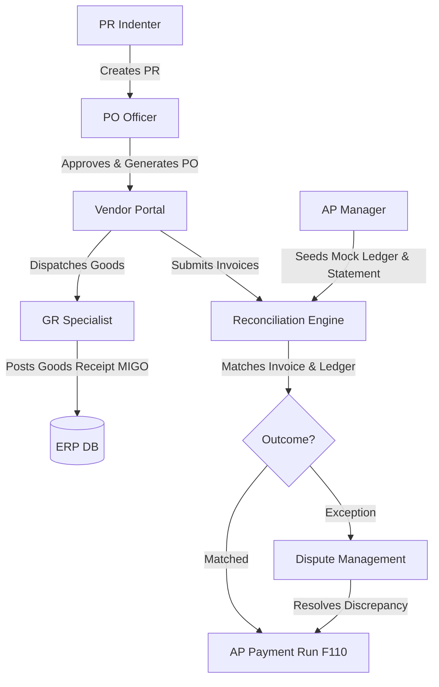

# Vendor Reconciliation & Match Exception Engine

A modern **SAP Cloud Application Programming Model (CAP)** and **SAPUI5** application designed to automate invoice matching, detect quantity/price/tax discrepancies, and manage accounts payable workflows.

---

## 🚀 Overview

The **Vendor Reconciliation & Match Exception Engine** automates the reconciliation of uploaded vendor billing statements against internal buyer ledger entries, purchase orders, and goods receipts. It identifies match discrepancies, generates actionable exceptions, and facilitates workflows across procurement, finance, warehouse, and supplier personas.



---

## 🛠️ Technology Stack

- **Backend**: [SAP CAP (Cloud Application Programming Model) Node.js Framework](https://cap.cloud.sap)
- **Database**: [SQLite](https://www.sqlite.org) (`db.sqlite`) via `@cap-js/sqlite`
- **Frontend**: [SAPUI5 / OpenUI5](https://sdk.openui5.org) (located in `app/vendordoclines/webapp`)
- **Testing & E2E**: [Playwright](https://playwright.dev) for UI automation, Custom Node.js runners for DB integration tests

---

## 📁 Project Structure

```
├── app/                      # SAPUI5 Frontend applications & configurations
│   └── vendordoclines/       # Main vendor reconciliation application UI
├── db/                       # Domain models and mock data database schemas
│   ├── data/                 # Initial seed CSVs / JSONs
│   └── schema.cds            # Database entities definitions (PR, PO, Exceptions, Invoices)
├── srv/                      # Custom handlers and service definitions
│   ├── handlers/             # Implementation of P2P, Matching Engine, Auth and Seed actions
│   ├── scenarios/            # Business validation logic for 10 distinct reconciliation scenarios
│   └── reconciliation-service.cds # Core service interface and API bindings
├── test-data/                # Integration testing scripts, mock XLSXs, and automation scripts
```

---

## 🔑 Security & Row-Level Isolation

The system enforces strict role-based access control and vendor isolation inside the custom handler hook in [reconciliation-service.js](file:///C:/projects/vendor_reconcile/srv/reconciliation-service.js).

| Business Role | System Role ID | Restrictions & Capabilities |
|---|---|---|
| **PR Indenter** | `PR` | Restricted to creating purchase requisitions. Can only view PRs and POs. |
| **PO Officer** | `PO` | Reviews, approves PRs, converts to POs, maps suppliers, and dispatches POs. |
| **Vendor Portal** | `VENDOR` / `AR` | Strictly isolated to their own `vendorCode`. Can only view and process their own POs and statements. |
| **Goods Receipt Specialist** | `GR` | Posts Goods Receipts (MIGO), resolves physical quantity discrepancy exceptions. Cannot see billing data. |
| **Finance Executive** | `FINANCE` | Enters MIRO ledger postings, runs the Matching Engine, clears invoices for payment. |
| **Accounts Payable Manager** | `AP` | Oversees uploads, raises disputes, creates payment proposals, and triggers F110 payment runs. |

---

## 📊 10 Core Matching Scenarios

The engine validates 10 business cases defined under [srv/scenarios/](file:///C:/projects/vendor_reconcile/srv/scenarios/):

1. **TC001: Standard Match**: Clear match on invoice number, amount, currency, and date.
2. **TC002: Invoice Qty Less than GR**: Quantity matches within acceptable tolerance limits.
3. **TC003: Invoice Qty More than GR**: Triggers an `UNMATCHED/QTY-MORE` exception; requires GR verification.
4. **TC004: Invoice Price Higher than PO**: Price discrepancy above PO rate. Raises `UNMATCHED/PRICE-HIGH`.
5. **TC005: Missing GR**: Invoice received before GR is posted in MIGO. Raises `UNMATCHED/GR-PENDING`.
6. **TC006: GST 2B Gap**: Invoice is missing in the buyer's GSTR-2B filing. Raises `UNMATCHED/GST-2B-GAP` to hold tax credit.
7. **TC007: TDS Section 194Q**: Automatically validates TDS 0.1% withholding deductions for MSME/large buyers.
8. **TC008: Payment in Transit**: Matches transactions in-transit with payment timing differences.
9. **TC009: Credit Note Missing**: Discrepancy where a vendor-issued Credit Note has not been posted in buyer's ledger.
10. **TC010: FX Revaluation**: Automatically handles foreign currency differences via revaluation checks.

---

## 🚀 Getting Started

### Prerequisites

Ensure you have [Node.js](https://nodejs.org) (v18+) and standard tools installed.

### 1. Installation

Install all project dependencies:
```bash
npm install
```

### 2. Run the Development Server

Start the CAP server locally. It automatically binds to a SQLite database `db.sqlite`:
```bash
npm run watch
```
The application will launch and be accessible at: [http://localhost:4004](http://localhost:4004).
The core API base URL is: `http://localhost:4004/api/v1`.

### 3. Execution & Testing

#### Interactive Step-by-Step Persona Runner
Simulate the entire P2P workflow or dispute process step-by-step from the command line:
```bash
run_personas_step_by_step.bat
```

#### Run All Backend Use Case Scenarios
Verify the matching accuracy across all 10 test cases:
```bash
node test-data/test_all_scenarios_e2e.js
```

#### Run Playwright End-to-End Tests
Launch the headed Chromium browser to automate UI workflows:
```bash
run_playwright_ui.bat
```

---

## 🛠️ API & Endpoints Summary

- **Authentication**: `/register` (POST), `/login` (POST)
- **Procure-to-Pay**:
  - `/createPR` (POST) - Create a PR
  - `/approvePR` (POST) - Approve a PR
  - `/createPO` (POST) - Generate a PO from a PR
  - `/sendPOToVendor` (POST) - Dispatch a PO
  - `/dispatchGoods` (POST) - Mark PO as dispatched
  - `/postGR` (POST) - Post Goods Receipt (MIGO)
- **Reconciliation Engine**:
  - `/uploadStatement` (POST) - Upload Excel supplier statements
  - `/runMatching` (POST) - Run the match engine
  - `/resolveException` (POST) / `/raiseDispute` (POST) - Exception workflow states
  - `/approveForPayment` (POST) / `/createPaymentProposal` (POST) / `/executePaymentRun` (POST) - AP clearing
